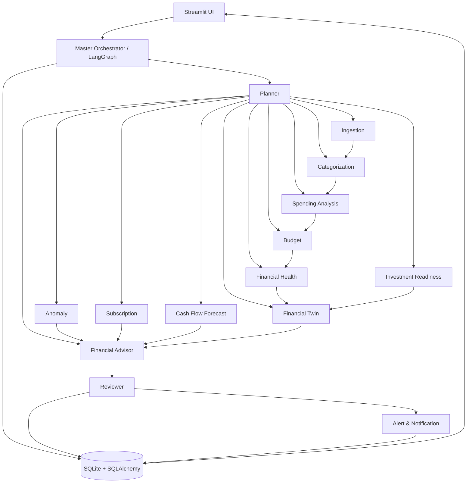

# Autonomous Financial Wellness Agent

**PS-05 — Personal Finance Agent | FinTech / Agentic AI | Streamlit**

An end-to-end, college-evaluation-ready **AI financial wellness system** that ingests synthetic bank/UPI/card data, analyzes spending, detects anomalies and subscriptions, forecasts cash flow, scores financial health, plans workflows with LangGraph, generates grounded recommendations, reviews them, raises proactive alerts, and persists the financial state in SQLite.

The project is designed to demonstrate the difference between an expense dashboard and a genuine agentic workflow: **planner → specialist agents → tools → shared state → reviewer → action → memory → feedback**. The uploaded specification explicitly requires these agentic proof points and a reproducible synthetic benchmark.

## 1. What is implemented

### Agentic layer
- **Master Orchestrator:** LangGraph stateful workflow with deterministic fallback.
- **Planner:** request-specific intent detection and agent selection; LLM plan is sanitized against an allow-list.
- **11 core agents:** Ingestion, Categorization, Spending, Budget, Health, Anomaly, Subscription, Forecast, Financial Twin, Advisor, Notification.
- **Reviewer:** validates required state, recommendation evidence and can reject/repair unsupported output.
- **Optional Investment Readiness Agent:** routed only when the request is about investment readiness; it does not recommend securities.
- **Memory:** SQLite + SQLAlchemy for transactions, budgets, goals, subscriptions, alerts, recommendations, simulations, health history and agent runs.
- **Observability:** per-agent status, timing, tool-call labels, input/output summaries and workflow trace.

### Deterministic finance / ML layer
- Hybrid transaction categorization: merchant rules → TF-IDF + Logistic Regression for ambiguous cases.
- Isolation Forest + robust local-spend rules for anomalies.
- Deterministic duplicate candidate detection.
- Subscription detection using known providers/category/explicit subscription evidence.
- Deterministic financial-health score from documented weighted components.
- Cash-flow forecasting using recurring schedules + recent net-flow behavior.
- Experimental monthly forecasting comparison: naive last-value vs 3-month moving average.
- Deterministic EMI, goal, car, salary-change and job-loss simulations.

### Application layer
- Polished Streamlit dashboard.
- **Load Demo Financial Profile** button for a zero-upload live demonstration.
- CSV ingestion for bank/UPI/card statements.
- PDF ingestion with PyMuPDF for synthetic statement PDFs.
- Tabs for Overview, Transactions, Spending Analysis, Anomalies, Subscriptions, Budget, Cash Flow, Goals, What-If, AI Advisor, Alerts and Agent Trace.

## 2. Synthetic benchmark

No real personal banking information is used. The generator is reproducible with **random seed 42** and creates:

- **18 synthetic users**
- **3,294 transactions**
- **6 months** of history
- UPI, bank and credit-card style activity
- salary, rent, EMI, utilities, groceries, food, transport, fuel, shopping, healthcare, education, entertainment, travel, insurance, subscriptions, investments and transfers
- **90 labeled anomalies**
- **72 labeled duplicate rows**
- known recurring subscriptions
- budget and goal ground truth
- synthetic PDF statements for HDFC, ICICI, SBI and a credit-card format

`USER001` is the judge-facing demo profile. Its food spending is deliberately constructed as approximately **₹5,000 → ₹6,500 → ₹8,000** in the first three months, followed by continued pressure, while the profile also contains anomalies, duplicates, recurring subscriptions, low cash-buffer risk and an at-risk car goal.

The specification requires a self-generated synthetic dataset rather than real banking data and asks for 6–12 months across multiple synthetic users.

## 3. Architecture



### Why this is agentic

1. **Planning:** the planner selects a request-specific workflow.
2. **Tool use:** deterministic Python functions perform financial arithmetic and ML operations.
3. **Multi-agent coordination:** specialist agents own different analytical responsibilities and pass results through shared state.
4. **Shared state:** transactions, analytics, budgets, forecasts, health, goals, recommendations and alerts are carried across the graph.
5. **Reviewer:** a separate reviewer can reject or repair unsupported output.
6. **Memory:** SQLite persists results beyond Streamlit session state.
7. **Proactive behavior:** a data-ingestion event automatically triggers analysis and alerts.
8. **Adaptation:** changing budgets, goals, salary or simulation assumptions causes a new evaluation of the financial state.
9. **Explainability:** recommendations and alerts contain evidence metadata.
10. **Feedback:** previous recommendations can be retrieved and compared with later spending behavior.

The project specification explicitly states that an LLM alone does not make the system agentic; planning, tools, coordination, shared state, review, memory, proactive behavior, adaptation and feedback must be demonstrated.

## 4. Project structure

```text
autonomous-financial-wellness-agent/
├── app.py
├── requirements.txt
├── README.md
├── .env.example
├── Dockerfile
├── pytest.ini
├── .gitignore
├── .streamlit/config.toml
│
├── agents/
│   ├── ingestion_agent.py
│   ├── categorization_agent.py
│   ├── spending_agent.py
│   ├── budget_agent.py
│   ├── health_agent.py
│   ├── anomaly_agent.py
│   ├── subscription_agent.py
│   ├── forecast_agent.py
│   ├── financial_twin_agent.py
│   ├── investment_readiness_agent.py
│   ├── advisor_agent.py
│   ├── notification_agent.py
│   ├── planner.py
│   ├── reviewer.py
│   └── orchestrator.py
│
├── tools/
├── analytics/
├── ml/
├── models/
├── config/
├── ui/
├── data/
├── data_generation/
├── tests/
├── notebooks/
├── docs/
└── artifacts/
    ├── evaluation/
    └── demo_snapshot.json
```

## 5. Quickstart

### Windows PowerShell

```powershell
python -m venv .venv
.venv\Scripts\Activate.ps1
pip install -r requirements.txt
python data_generation/generate_dataset.py
pytest -q
python -m ml.evaluation --csv data/synthetic_transactions.csv --output-dir artifacts/evaluation
streamlit run app.py
```

### macOS / Linux

```bash
python -m venv .venv
source .venv/bin/activate
pip install -r requirements.txt
python data_generation/generate_dataset.py
pytest -q
python -m ml.evaluation --csv data/synthetic_transactions.csv --output-dir artifacts/evaluation
streamlit run app.py
```

Then click **Load Demo Financial Profile**.

## 6. Environment variables / LLM configuration

A `.env` file is present in the project root (created from [.env.example](file:///c:/Users/cbec/Downloads/autonomous-financial-wellness-agent/autonomous-financial-wellness-agent/.env.example)).

### Option A: Google Gemini (Recommended)

```env
LLM_PROVIDER=google
GOOGLE_API_KEY=your_gemini_api_key
MODEL_NAME=gemini-3.8-flash
```

### Option B: Grok by xAI (Free fallback when Gemini is busy)

```env
LLM_PROVIDER=grok
XAI_API_KEY=your_xai_api_key
MODEL_NAME=grok-3-mini
```

### Option C: OpenAI-compatible provider

```env
LLM_PROVIDER=openai
OPENAI_API_KEY=your_api_key
OPENAI_BASE_URL=https://api.openai.com/v1
MODEL_NAME=your_model
```

The app automatically reads your key from `.env` and displays a connection status badge (`✅ AI connected` / `⚠️ AI offline`) in the Streamlit sidebar. No manual key entry in the browser is needed.

The application also works fully in deterministic mode without any API key. All financial totals, health scores, anomaly flags, and forecasts stay mathematically grounded.

## 7. Evaluation

Run:

```bash
python -m ml.evaluation --csv data/synthetic_transactions.csv --output-dir artifacts/evaluation
```

This generates:

- `evaluation_results.json`
- `categorization_comparison.csv`
- `anomaly_comparison.csv`
- `agent_evaluation.json`
- `agent_case_evaluation.csv`
- `categorization_comparison.png`
- `anomaly_comparison.png`
- `forecast_mae_comparison.png`

### Current measured benchmark

| Component | Metric | Result |
|---|---|---:|
| Categorization – rule baseline | Accuracy | 79.61% |
| Categorization – ML | Accuracy | 100.00% |
| Categorization – hybrid | Accuracy | 100.00% |
| Anomaly detection | Precision / Recall / F1 | 100.00% / 100.00% / 100.00% |
| Duplicate detection | Precision / Recall / F1 | 100.00% / 100.00% / 100.00% |
| Forecast – naive | MAE / RMSE / MAPE | ₹4,454.06 / ₹5,550.36 / 6.37% |
| Forecast – moving average | MAE / RMSE / MAPE | ₹5,161.82 / ₹6,413.92 / 7.33% |
| Agent planning success | Rate | 100.00% |
| Agent tool-selection success | Rate | 100.00% |
| Grounded recommendation rate | Rate | 100.00% |
| Context-relevant response rate | Rate | 100.00% |
| Hallucination proxy | Rate | 0.00% |
| Reviewer rejection on seeded invalid cases | Rate | 100.00% |

These are actual outputs from the reproducible synthetic benchmark, not invented claims. The anomaly/classification results should **not** be interpreted as real banking performance because the synthetic anomalies are deliberately separable and the classification benchmark contains repeated merchant patterns.

The project specification explicitly requires actual measured results rather than fabricated metrics.

## 8. Judge-friendly demo

Recommended live sequence:

1. Click **Load Demo Financial Profile**.
2. Show Overview and the health score / cash-flow risk.
3. Show the rising food/spending trend.
4. Show one of the unusual transactions and the duplicate candidates.
5. Show the three recurring subscriptions.
6. Show the cash-flow forecast.
7. Show the at-risk car goal.
8. Ask: **“Can I afford a ₹12 lakh car?”**.
9. Open **Agent Trace** and show `Planner → Health → Forecast → Financial Twin → Advisor → Reviewer → Alerts`.
10. Ask: **“What if my salary increases by ₹15,000?”**.
11. Ask: **“How can I save ₹5,000 more per month?”**.

The car question uses deterministic EMI and financial-state simulation rather than asking the LLM to invent an affordability number. This mirrors the requested definition-of-done workflow.

## 9. PDF ingestion

Synthetic statements are generated with ReportLab and parsed with PyMuPDF. The repository includes:

```text
data/sample_pdfs/
├── HDFC_statement.pdf
├── ICICI_statement.pdf
├── SBI_statement.pdf
└── credit_card_statement.pdf
```

The PDFs are demonstration fixtures only; they contain synthetic records.

## 10. Testing

```bash
pytest -q
```

The suite covers PDF parsing, subscription detection, anomaly detection, forecasting, goals, EMI, planner routing and an end-to-end orchestrator run.

## 11. Deployment

### Streamlit Community Cloud

1. Push the repository to GitHub.
2. Select `app.py` as the Streamlit entry point.
3. Install dependencies from `requirements.txt` automatically.
4. Add secrets through Streamlit's Secrets settings rather than committing `.env`.
5. Use `LLM_PROVIDER=none` for a deterministic demo, or configure a supported provider.

### Docker

```bash
docker build -t autonomous-financial-wellness-agent .
docker run -p 8501:8501 autonomous-financial-wellness-agent
```

## 12. Database

SQLite is the default persistence layer. The schema includes:

`users`, `transactions`, `budgets`, `goals`, `subscriptions`, `alerts`, `agent_runs`, `recommendations`, `simulations`, and `financial_health_history`.

Streamlit `session_state` is used only for the current UI session; the core financial state is persisted in SQLite so later runs can retrieve it.

## 13. Safety

This is an **educational financial wellness assistant**, not a regulated financial advisor. It does not provide individualized stock, crypto or security-selection recommendations. Predictions are estimates and important financial decisions should be independently verified.

The application avoids claiming a subscription is definitely unused when transaction data contains no usage telemetry; it instead reports a **potentially unused / review candidate**.

## 14. Research documentation

- `docs/literature_review.md` — 14 verified papers and a project-level research gap.
- `docs/methodology.md` — dataset, analytics, ML and agent methodology.
- `docs/architecture.md` — architecture and agentic proof points.
- `docs/project_report.md` — report draft covering dataset, problem definition, literature review, system design, technology, implementation, results and conclusions.
- `notebooks/evaluation.ipynb` — reproducible evaluation entry point.

## 15. License / academic-use note

This repository is intended as an academic demonstration and research-project starting point. Replace synthetic data, heuristic thresholds and lightweight forecasts before considering any real financial deployment.
