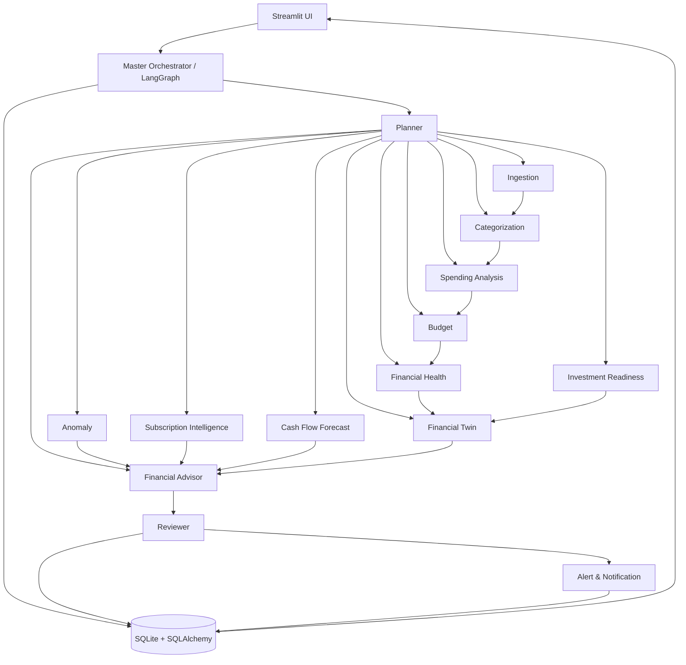

# Conceptual System Architecture

## Runtime execution model

The runtime state is a `FinanceState` TypedDict. The planner chooses a subset of specialist nodes from the current request. LangGraph executes those nodes in the selected order, and each node reads/writes only the state fields it owns or depends on. The reviewer runs after the advisor and can reject or repair unsupported recommendations before alerts are produced and state is persisted.

## Agentic proof points

1. **Planning:** the planner selects a request-specific agent sequence.
2. **Tool use:** numerical work is implemented as explicit Python tools/functions; the trace records the tool names associated with each agent.
3. **Multi-agent coordination:** ingestion feeds categorization, analytics feed budget/health/forecast, and those outputs feed the advisor.
4. **Shared state:** the graph carries transactions, analytics, budgets, health, anomalies, subscriptions, forecasts, goals, recommendations, alerts and the financial twin in one state object.
5. **Reviewer:** the reviewer checks plan-dependent outputs and evidence metadata, then removes unsupported recommendations when repair is possible.
6. **Memory:** SQLite persists transactions, budgets, goals, subscriptions, recommendations, alerts, agent runs and financial-health history.
7. **Proactive behavior:** loading or uploading data automatically executes the analysis cycle and emits alerts without a separate user question.
8. **Adaptation:** budget edits, new goals and what-if scenarios cause a new workflow run from the updated state.
9. **Explainability:** recommendations and alerts retain deterministic evidence metadata.
10. **Feedback loop:** previous recommendations can be retrieved from memory and considered by the advisor/planner layer.

## Financial Twin

The twin is a compact state representation of balance, income, expenses, savings capacity, debt ratio, emergency-fund coverage, health score and goal status. Scenario functions can apply an event such as a car purchase, salary change or job loss and compare the resulting state with the baseline.
